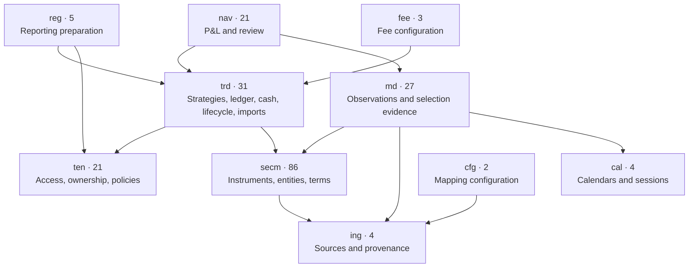
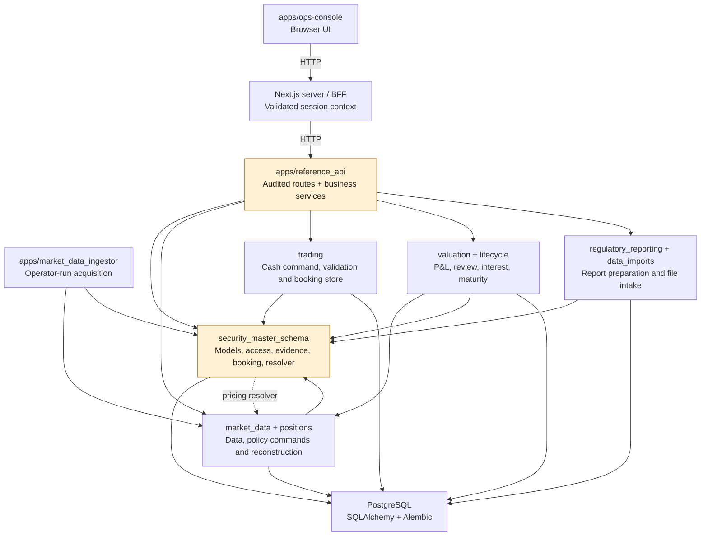
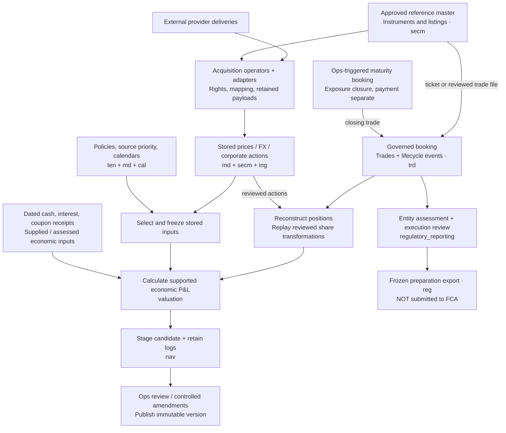

# Architecture atlas

31 October extension: [reviewed missing marks](../../delivery/incomplete-price-review-20261031.md)
adds retained manual-mark requests/decisions to `nav`, alongside existing staged
P&L. Missing-input proof and mark selection/review live below HTTP in `valuation`;
provider observations remain separate. Inventory counts below are still the
explicitly dated 29 October baseline.


**Reviewed:** 29 October 2026 · current working tree and local schema 104.
**Scope:** database organisation, source structure and representative end-to-end
data paths. This is an architecture inventory and bounded source trace, not a
whole-code correctness/security audit or a target microservice architecture.

**Same-day update:** diagrams and ownership notes include the
[phases 1–3 service extraction](../../delivery/api-service-extraction-20261029.md)
and the [cash-booking trading domain](../../delivery/cash-booking-service-extraction-20261029.md).
The saved inventory/register counts remain the explicitly dated **pre-extraction
baseline**; they were not regenerated or relabelled as a fresh database audit.

## Read the diagrams

1. [Database](#database-organisation): logical schemas and their primary references.
2. [Code](#codebase-organisation): running applications, domain packages and reverse dependencies.
3. [Data](#data-flow): how source records become booked trades, selected inputs,
   reviewed P&L or regulatory preparation.
4. [Exact inventory](database-register.md): all 204 table names and their outbound
   foreign-key targets, complete schema-reference counts and code dependency counts.
   [Pre-extraction machine-readable evidence](inventory-20261029.json) retains constraint columns,
   source files/import locations, live triggers and API/UI inventories.

Different arrows answer different questions. A foreign key means one table
references another, not that a job runs in that direction. A static Python import
does not prove a runtime call, execution frequency or an import-time failure.
Business-flow arrows show processing, not foreign-key orientation. Schema names
are logical namespaces inside the same database; they are not tenant databases.

## Database organisation

**204 runtime-modelled and deployed tables, ten schemas, 611 foreign-key
constraints and 81 non-internal application triggers.** Local revision:
`20261029_104`. No application views/materialized views were found in this
catalogue inspection. The table sets, per-table column counts and FK source/target
multiplicities agree between complete runtime metadata and the deployed catalogue.
This does not certify
column defaults, data types, index coverage, triggers or every migration detail.

The main model import initially exposes 202 tables. Importing
`data_imports.tables` registers the two additional file-intake tables. This is an
import-order/metadata-discovery quirk, **not two missing schema migrations**.

Arrows below point from the dependent schema to a referenced schema. They show
the main business references only. Secondary/reverse references and exact counts
are deliberately retained in the [complete register](database-register.md), not
hidden by treating this overview as a complete ERD.

<!-- database.mmd is the identical standalone Mermaid source. -->


| Schema | Purpose and representative records | Implementation owners / limits |
| --- | --- | --- |
| `secm` (86) | Reference graph, instruments/listings, terms, organisations, currencies, source datasets/licences and corporate actions. | Shared models/reference services; several governance/provider concepts also live here, so the name is narrower than its actual responsibility. |
| `ten` (21) | Tenant directory, modules, user/group grants, strategy scope, reference visibility, dataset access, valuation policies/rules. | Access services, API and market-data policy selection. Application-enforced tenancy in one local database. |
| `trd` (31) | Strategies, immutable executions/events, trade fields/parties/tags, cash accounts/snapshots, maturity preparations/postings, coupon confirmations and file-import records. | Trading cash commands, other booking/API paths, positions, lifecycle, valuation cash inputs and intake. One schema has several clear subdomains rather than one code owner. |
| `md` (27) | Time series/observations, ingestion jobs/attempts, source priorities/rights, resolution snapshots, quote-accrual and price-basis proof. | `market_data`, resolver and ingestion operators; no provider fetch during normal valuation. |
| `nav` (21) | Active P&L attempts/events, attributions, review batches, amendments, ledger-change evidence, daily accrued inputs and balances; older NAV-foundation records also exist. | `valuation`. Its schema name does not mean a full accounting NAV engine is implemented. |
| `reg` (5) | Reporting profiles/revisions, transaction candidates/revisions and immutable preparation exports. | `regulatory_reporting`; preparation only, no regulator submission/acceptance. |
| `ing` (4) | Integration sources, external identifier namespaces/mappings and retained payloads. | Shared provenance foundation used by reference and market-data ingestion. |
| `cal` (4) | Calendars, sessions, holiday exceptions and assignments. | Governed calendar services and contractual/valuation selection. |
| `fee` (3) | Fee types, rules and rule targets. | Modelled foundations; not evidence of a completed general fee/accrual/accounting engine. |
| `cfg` (2) | Generic external-data object/mapping profiles. | Modelled integration configuration; presence alone does not establish a complete user workflow. |

Many cross-schema references are ordinary user, tenant, currency or provenance
keys. Those links are expected relational integrity, not proof of tangled
financial logic. Database schema cycles are not the same thing as code-layer cycles.

The catalogue has no enabled table-level PostgreSQL RLS in these application
schemas. Current isolation is implemented through tenant/action/strategy and
dataset predicates in the API/domain services, with ownership/FK/trigger integrity
checks in the database. Absence of RLS is not itself evidence of an isolation
breach. This is the documented local
alpha boundary; production authentication and isolation assurance remain separate
work. [Access boundary](../../../apps/reference_api/access_boundary.py),
[strategy predicates](../../../security_master_schema/strategy_access.py) and
[rights selection](../../../market_data/entitlements.py) are more meaningful
security boundaries than the schema names.

## Codebase organisation

The application is a **modular monolith**: one Python API, one Next.js console and
operator-run market-data entry points sharing one PostgreSQL installation. Domain
folders are not independently deployed services. The API still owns substantial
business orchestration, not merely transport.

Solid arrows are primary calls/dependencies; dashed arrows mark selected reverse
helper dependencies worth tidying. This is a component overview, not every import.



```text
apps/
  ops-console/               Next.js pages, client UI, server/BFF, browser checks
  reference_api/             Audited HTTP routes, contracts, repositories, booking/import services
  market_data_ingestor/      Operator entry points; not a scheduled-worker fleet
security_master_schema/     Shared models + access/reference/booking/selection services
market_data/                Providers, acquisition storage, rights, policies, calendars and proof
trading/                    Cash commands/models/store and shared booking validators
positions/                  Ledger reconstruction and compatible position grouping
valuation/                  Input preparation, supported P&L, cash/interest, review/publication
lifecycle/                  Coupon schedules/receipts and maturity booking workflows
regulatory_reporting/       Entity assessment, preparation, review and frozen exports
data_imports/               Bounded file formats and retained intake tables
alembic/                    Schema migrations and durable database invariants
packages/api-contracts/     OpenAPI + generated TypeScript contracts
packages/auth, ui/          Shared/scaffold packages; not separate deployed services
packages/test-fixtures/     Synthetic fixtures
scripts/                    Operator/setup/maintenance commands
tooling/reconciliation_csv/ Optional external-source convenience tooling; outside product runtime
tests/                      Python assurance; console tests live alongside UI/browser sources
docs/                       Canonical maintained knowledge
security-master-notes/,
ui/, fintech-moduls/        Supporting foundations/specifications/research, not runtime apps
```

The `packages/ui` package and root `ui/` documentation tree are different things.
The console currently declares `api-contracts` plus MUI/React/Next dependencies;
the other shared packages should not be mistaken for an implemented identity
service or a mandatory runtime UI layer.

The pre-extraction scanned runtime Python packages contained 257 source files. The console had 353
non-test TS/TSX/CSS files, 53 App Router pages and 77 BFF route handlers. The saved
OpenAPI describes 190 paths / 211 HTTP operations. These are structural counts,
not active feature counts, performance measurements or a code-quality score.

### Where the structure is clean

- Browsers call same-origin BFF endpoints; Next's server/BFF propagates validated
  local context to Python. Browser code does not query PostgreSQL or own financial totals.
- Provider-specific acquisition has a dedicated operator/provider boundary.
  Corporate actions, mapping, rights and observations retain source evidence.
- Position reconstruction, valuation, lifecycle and reporting are identifiable
  packages. Regulatory preparation reads execution facts directly, not P&L output.
- Alembic owns deployed constraints/triggers; frozen history and current review
  projections are intentionally distinct records, not accidental duplication.
- External CSV reconciliation is separate optional tooling. It is not a hidden
  startup dependency or a generic product ingestion subsystem.

### Where the structure remains coupled

These are confirmed source-layout dependencies, not demonstrated financial bugs:

The selected helper edges in the original inventory are now resolved: accruals
use shared visibility, amendments/bond maturity use shared locks, and market-data/
positions/lifecycle use `security_master_schema.evidence`. Pricing-policy creation
and models are shared in `market_data`, with HTTP response mapping retained in the
API. The FX setup operator no longer imports API policy code. These changes retain
the original algorithms and caller-owned transactions; compatibility exports are
the same objects where existing import paths remain in use.

The cash pilot further gives the HTTP/file writer an independent `trading` owner:
original command models, annotations, reference checks, recognition and linked
correction helpers are shared without API imports. Response/read DTOs remain in
the API. The generic-swap currency-lock caller bug found by the baseline is fixed;
its currency-change guard is retained. Other product writers, cancellation and
reference/proposal orchestration remain outside this completed cash slice.

| Actual dependency | Why it appears / implication | Bounded cleanup direction |
| --- | --- | --- |
| `security_master_schema/market_data_resolver.py` ↔ `market_data` | The foundation directory contains higher-level pricing selection as well as schema primitives. | Clarify/split model/shared primitives from market-data resolution incrementally. |
| API reference/other-product booking and policy catalogue/options/preview adapters | Policy creation and cash booking now have shared owners; other workflows remain. Pre-extraction repository/contracts/factory sizes were 5,211/1,476/1,244 lines. | Continue by coherent capability with contract/replay tests, not file-size targets. |
| `models.py` (3,064 lines) + registration callbacks | One central schema graph, with separate table registries and late intake registration. | Provide one explicit metadata bootstrap and domain table registries before claiming a clean dependency DAG. |
| Autocall form (1,155 lines) | One substantial frontend feature remains concentrated. | Split form sections/state validation carefully if that workflow is next changed. |

The generated API TypeScript file is 30,705 lines. That is generated output, not
a hand-maintained refactoring hotspot. Seeds/fixtures also account for sizeable
files and must not be confused with live orchestration.

At coarse package-family level, the pre-extraction static import graph was strongly connected
across API/foundation/market-data/positions/valuation/lifecycle/reporting/intake,
even after excluding model-registration edges. This grouping includes deferred
and conditional imports. It **does not prove a Python module import-time cycle**,
a runtime exception or that every package depends directly on every other one.
The concrete edges above are the actionable evidence; a graph score is not.

## Data flow

The drawing follows business processing. It is intentionally independent of the
database FK arrow direction. All tenant-facing reads/commands retain current
authority checks; provider rights additionally constrain acquisition/storage/use.



1. Reference proposals become approved canonical instruments/listings through
   governed approval. Trades freeze the approved execution conventions.
2. Supported trade-file intake validates and retains a review before invoking the
   same governed booking path; it does not bypass validators or create a parallel ledger.
3. Acquisition operators store source payloads, mappings, observations, corporate
   actions and run evidence. They are not automatically invoked by valuation.
4. Position reconstruction reads immutable trades/lifecycle history, applies the
   selected economic/information boundary and reviewed quantity transformations.
   It does not rewrite the original trades; it is not a FIFO/tax engine.
5. Policies, provider priority, rights, calendars, price conventions and information
   cutoffs select stored price/FX evidence. Missing compulsory inputs can block a
   calculation; optional income/cash coverage remains separately disclosed.
6. Valuation combines supported positions, selected prices/FX and supplied cash/
   interest/coupon/economic inputs. Attempts/logs are retained even when no staged
   financial result is produced. Successful candidates stage immutable evidence.
7. Review/publication retains version, operator and current-source/access checks.
   A controlled component amendment makes a reviewed successor; it does not mutate
   original financial evidence. Published history is not silently repriced.
8. Regulatory preparation independently reads executions plus entity/mapping
   assessments. Its exports do not consume P&L and are not FCA submissions.
9. Ops-triggered bond/FX-forward maturity workflows can post exposure-closing
   ledger entries. Payment confirmation/cash balances remain separate; no
   automatic settlement-accounting engine is implied by that loop.

## Assessment and sensible next cleanup

The **business organisation is understandable**, and the live schema/model graph
is reconciled at the inspected level. The **code does not yet have uniformly clean
layering**: broad API services, helper placement and metadata registration create
avoidable reverse dependencies. A domain-organised database does not by itself
make the Python dependency graph a clean hierarchy.

Keep the present deployment. The selected domain/API helper imports and generic
evidence placement are now corrected, and policy creation is the first extracted
capability; the cash-booking pilot now follows it. Broader reference/other-product
booking services and explicit metadata bootstrap remain future work. Preserve
all tenant checks, hashes, immutable proof, financial formulas
and replay behaviour with focused parity tests. No rewrite, database split or
service-per-folder deployment is recommended by this inventory.

This extends the existing [BACKEND-009 finding](../../../FIX.md#backend-009--p3--domaintransport-boundaries-and-legacy-interfaces-have-drifted),
not a claim that earlier remediation never happened. The original atlas changed
no application code. Subsequent work changed source ownership/tests and fixed
the separately recorded generic-swap currency-lock caller regression;
schema, permissions, trades, reports and running services were unchanged.

## Evidence and maintenance

Standalone diagram sources: [database](database.mmd), [codebase](codebase.mmd),
[data flow](data-flow.mmd). Rendered images are available in [SVG/PNG assets](assets/).

- Full inventory of declared table names/columns/foreign keys after runtime table
  registration; read-only PostgreSQL catalogue comparison at schema 104. No
  business rows, credentials, role names or connection URLs are in the saved inventory.
- AST scan of runtime Python and separately classified operator/optional tooling;
  305 non-test Python files scanned, zero syntax-parse errors. Line counts include
  comments/blank lines. TypeScript counts are file inventory, not a full TS import graph.
- Traced shared API/BFF authority, booking/intake, provider ingestion, position
  reconstruction, selected inputs, valuation staging/review and regulatory preparation.
  This is representative flow tracing, not a line-by-line audit of every function.
- The two late-registered intake tables were explicitly included before judging
  model/database agreement. Views, non-internal triggers and RLS-enabled flags
  were read from catalogues; trigger bodies and all SQL expressions were not audited.
- Counts describe the pre-extraction dirty working tree, not only HEAD. Older dated
  diagrams/specifications are not silently promoted to current runtime truth.
- Current code diagrams reflect the extraction; keep the saved baseline distinct
  from any later inventory. Regenerate when a new counted snapshot is needed. Do not
  infer runtime activity, completion, causality or query speed from dependency counts.

The diagram approach follows [C4's levels of zoom](https://c4model.com/diagrams)
and [component guidance](https://c4model.com/diagrams/component), opened 29 October;
the choice of these three views is project-specific. PostgreSQL documents
[schemas as namespaces](https://www.postgresql.org/docs/18/ddl-schemas.html), not
independent database or tenant-isolation boundaries. Source/model evidence above,
not those generic references, establishes the actual project structure.
