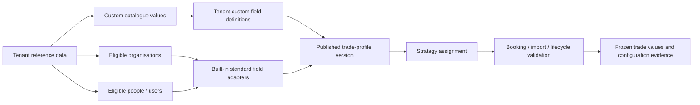

# Tenant reference data and strategy trade profiles

**Status:** Implemented alpha; [delivery and verification](../../delivery/tenant-reference-data-trade-profiles-20261104.md).
**Reviewed:** 4 November 2026.
**Scope:** Tenant-maintained reference data, standard/custom trade metadata, reusable trade profiles and strategy assignment. F20/F24/F51 coverage is reconciled in the capability records; broader product/lifecycle restrictions remain.

## Decision

Use tenant-owned reference data and immutable published trade-profile versions, with one explicitly assigned version per strategy. Reuse current catalogues, organisations, people and immutable annotation tables. Do not create a generic untyped database for all business data, copy configuration independently into every strategy, or introduce cascading overrides.

A profile selects metadata fields and required/optional/not-used behavior, and owns lifecycle allocation/inheritance rules. Standard field meaning, native product requirements, user permissions and catalogue integrity remain server-controlled. The profile cannot make an obligatory swap counterparty or core economic input optional. Funds, AMCs and sleeves are strategy classifications, not automatic profile assignments.

## Pre-implementation foundation (historical design rationale)

- [Schema](../../../security_master_schema/models.py): `trd.reference_catalogue` and versioned `reference_catalogue_record`; tenant-owned `trade_property_definition`, scalar/reference assignments, standard-role selection policies and canonical organisation/person links already exist.
- [Current field commands](../../../apps/reference_api/trade_configuration.py): required status is definition-wide, and replacements create a new definition UUID/version within the same tenant/code family.
- [Current validator](../../../trading/annotations.py), `validate_trade_annotations`: before this change, all active tenant-required definitions were required for each new booking. Changing only the UI would leave this restriction in place.
- [Current catalogue commands](../../../apps/reference_api/governed_trade_configuration.py) and [organisation service](../../../apps/reference_api/tenant_organisations.py): reuse their governance, audit and canonical identity checks. Catalogue logic is currently partly inside the API package; extract only the shared dependency closure needed here.
- [Current UI](../../../apps/ops-console/src/app/tenant-profile/trade-configuration/trade-configuration-console.tsx) mixes field definitions, catalogue maintenance, standard-role eligibility and audit. [Lifecycle allocation policy](../../../trading/allocation_policy.py) was tenant-wide before this change.
- [File adapter](../../../apps/reference_api/import_adapters/trades.py), direct product writers and [lifecycle preparation](../../../lifecycle/allocations.py) share annotation behavior. All need the same profile resolver; no cash-only or frontend-only enforcement.

## UI: separate maintenance, rules and usage

Use ordinary navigable pages for distinct tasks, with breadcrumbs and bookmarkable URLs. Keep local tabs for sections of a selected object, not a giant nested settings screen.

| Location | User goal and display |
| --- | --- |
| Tenant profile -> Reference data (`/tenant-profile/reference-data`) | Searchable catalogue register: name, source kind, status, active entry count and usage. Organisation and trader sources are labelled canonical sources; custom lists are tenant maintained. |
| Reference-data detail (`/tenant-profile/reference-data/catalogues/[catalogueId]`) | Entries / Used by / History. Search entries, add, correct or retire; show changes and reason. Used by links fields and profiles, then authorised strategies. |
| Existing Organisations page | Remains the authoritative place to adopt organisations and maintain roles. Link to it; do not create duplicate organisation editors or string copies. |
| Trade configuration (`/tenant-profile/trade-configuration`) | Profiles / Field library / History. Profiles is the default landing view after cutover. Clearly distinguish data maintenance from booking requirements. |
| Profile detail (`/tenant-profile/trade-configuration/profiles/[profileId]`) | Overview / Fields / Lifecycle rules / Used by / History. Always display selected version and published/retired/unsaved state. |
| Strategy detail (`/strategies/[strategyId]`, Trade configuration section) | Show assigned profile and exact version, current effective requirements and an authorised Change profile action. Link to the tenant profile editor rather than duplicate it. |
| Booking and lifecycle tickets | Show strategy and applied profile/version near the top; display applicable fields. Read-only users can inspect authorised effective configuration without configuration-admin privileges. |

### Screen behavior

- Tables favour names, codes and business context; UUIDs are secondary technical details. Show explicit loading, failed, empty and filtered-empty states. Counts, search and pagination run across the complete server-side scoped population, not a loaded first page. Default 25 rows; allow 50/100 for catalogue/profile/usage registers.
- The field library defines meaning, scalar type and source binding. It no longer offers a tenant-wide Required toggle after cutover. Provide a compact Used by count and links. A different meaning/type/catalogue binding requires a new field code; label/description revisions keep the same meaning and are explicitly adopted by profiles.
- A profile Fields table has Field / Kind / Source / Requirement, with a row editor for details. Standard and custom fields share the presentation, but standard sources are fixed. Use a separate Lifecycle rules section for allocation versus metadata inheritance; do not cram both workflows into every field row.
- Native selects suit the three behavior choices. Catalogue, profile and entity selection use labelled, keyboard-operable server-backed search; no UUID entry, enormous select lists or dual-list widgets containing the whole tenant universe. Preserve selected off-page values and ignore stale search responses.
- Editing creates an explicitly **unsaved local draft** in the first release; do not claim server-saved drafts. Existing unsaved-navigation protection applies. Publishing creates a new immutable version and does not silently upgrade assignments.
- Review before publication shows exact field/rule differences, affected strategy count and unavailable dependencies; reason is required. Publishing a profile and applying it to strategies are distinct actions with explicit feedback. A separate Apply version review selects authorised strategies and exposes conflicts; bulk selection is never implicitly all tenants/all strategies.
- Reference data -> field -> profile -> strategy links preserve origin/context. Existing catalogue deep links remain redirects to the same identity, not duplicate editors. Existing how-to help explains maintenance versus configuration, standard identity sources and publication impact.
- Keyboard focus, labels, error summary plus inline errors, status announcements and mobile containment are acceptance criteria. Tabs that load server data activate manually. Do not hide mandatory blockers in collapsed technical evidence, or communicate state using colour alone. Local styles must not inherit compact evidence-disclosure/table sizing, as the allocation-editor correction demonstrated.

## DB organization

### Reuse rather than rename

Keep existing physical `trd.reference_catalogue*` tables and immutable trade annotations. A tenant-wide UI does not require moving tables into a different schema. Document them as shared tenant reference data; a physical schema rename is not part of this feature.

Custom lists remain catalogue entries with stable `record_id` and immutable `record_version_id`. Standard sources remain typed references: organisation UUID for counterparty/broker, person UUID plus active tenant-account eligibility for trader. A combined API registry can present these consistently without a polymorphic `entity_type/entity_id` table or a duplicate row for every organisation/user.

### Proposed core relations

Exact migration numbers are assigned at implementation time after reviewing current Alembic head; do not reserve or apply one from this plan.

| Relation/change | Key and responsibility |
| --- | --- |
| `trd.trade_profile` | Stable profile UUID, tenant, immutable tenant-local code, active/retired status and audited identity metadata. Unique tenant/code. |
| `trd.trade_profile_version` | Immutable published version UUID, tenant/profile FK, version number, label/description, actor, UTC publication time, reason and deterministic content hash. Unique profile/version. No JSON-only rule document. |
| `trd.trade_profile_field_rule` | Version-owned rule UUID, tenant, standard-field key **or** custom code/version, requirement and lifecycle behavior. Typed nullable alternatives with an exactly-one-source CHECK. Unique field family within a profile version. |
| `ten.strategy_trade_profile_assignment` | Append-only strategy assignment revision, tenant/strategy, pinned profile-version FK, actor/time/reason and previous assignment. Latest committed revision is current. Optimistic expected revision prevents concurrent overwrite. |
| `ten.tenant_trade_profile_default` | Retained tenant default revisions referencing a published profile version; used to materialise an explicit assignment when a strategy is created. No runtime fallback for unassigned existing strategies. |
| New nullable configuration-version/assignment references on `trd.trade` | Set on new bookings; also freeze the resolved configuration hash/source versions in new BOOKED evidence. Existing trades stay genuinely pre-profile and keep their original bytes. No fabricated retrospective assignment. |

The custom-field identity already has a stable family `(tenant_id, code)` and immutable version `(tenant_id, code, version_no)` with a unique constraint. Reuse that family rather than introduce another field identity table. A profile rule uses a composite FK to the selected custom version; the booking adapter resolves its existing `definition_id`. Standard field keys come from a finite backend registry, not arbitrary user strings.

A profile cannot select two versions of one custom field. Scalar rules cannot have catalogue-member restrictions; source/type agreement is validated before publication. Catalogue identity/type changes are not label edits. Lifecycle signatures use stable field family plus stable record identity while retaining exact definition/record-version proof; test this transition explicitly against the current UUID-keyed implementation.

Add composite tenant-aware FKs/unique targets for all new ownership relationships, including tenant/profile-version and tenant/strategy, not UUID existence alone. Use ordinary CHECKs for same-row alternatives/enums and FKs for cross-table ownership; do not query other tables from CHECK expressions. Index assignment `(tenant_id,strategy_id,revision DESC)`, version `(tenant_id,profile_id,version_no DESC)`, rule profile lookup and reverse Used by lookups. Verify plans/counts with representative populations; do not introduce per-row catalogue/permission queries.

Mutable identity status uses audited commands; published versions, assignments and audit evidence are append-only and protected against update/delete. Primary authorization and strategy scope remain mandatory; these new constraints supplement them.

### Optional narrower value sets (after core cutover)

Initially, a profile's reference fields use all currently eligible records from their bound tenant source. This fully supports different fields and requirements between strategies without duplicating lists.

If narrower lists are needed, add explicit ALL_ELIGIBLE versus SELECTED scope and **typed** membership tables: custom stable record identities separately from organisation/person memberships. Empty SELECTED means no eligible values, never ALL. Membership only narrows the active tenant source; it cannot grant access or widen role eligibility. Introduce a stable catalogue-record identity relation populated from existing record IDs if needed for real composite FKs; do not turn version labels into identity or silently pin only one display revision. This extension is deferred, not silently included in the core delivery.

## One authoritative resolver

Proposed owner: `trading/profiles/`, below HTTP. Proposed catalogue-source service: `tenant_reference/`, with typed custom-catalogue, organisation and trader adapters; retain current authority predicates and use existing canonical stores.

`resolve_trade_configuration(connection, tenant_id, strategy_id, actor_id, operation, expected_assignment_revision=None)` returns a typed resolved context: assignment/profile version, requirements, source descriptors, lifecycle rules and configuration hash. The actor/action/strategy checks are specific to the consumer; a read lookup must never grant configure authority or leak another strategy's usage.

Effective requirement = native product/operation minimum plus profile requirements. The profile may make an optional field mandatory, but cannot remove native inputs or change standard meanings. NOT_USED fields are unavailable for new manual input and rejected if supplied, except for explicitly proven source-preserving correction/lifecycle metadata. No arbitrary formulas or per-product requirement-language engine in this increment.

Apply this resolver to cash, bond, option, future, FX, funded-note and swap writers that exist, fund transfer/reinvestment, linked corrections, import validation/confirmation/templates and bond/FX lifecycle preparation/posting. Keep existing product-specific economics/authority. Every fresh write rechecks assignment revision and catalogue/party eligibility; stale tickets/import reviews require reload/revalidation, not silent adoption. An already successful unchanged retry returns its immutable receipt after current authority checks; profile changes must not create a second trade or rewrite old evidence.

## Open positions, history and profile changes

- New backdated bookings use the current assigned profile at command time; execution/valuation dates do not choose old configuration implicitly. A materially different historical policy needs a separately scoped capability.
- Ordinary trade values and prior BOOKED evidence remain immutable. Display old profiles/definitions for readback while still enforcing current visibility.
- Non-allocation changes apply only to future entries. A correction may preserve exact original now-hidden metadata as evidenced history; newly entered metadata must meet current requirements. Explain newly mandatory fields before confirming corrections.
- A profile version can be published without changing any strategy assignment. Applying a changed allocation field family or type/source requires an impact preview across complete eligible history, existing open allocations and prepared lifecycle entries. No FIFO guessing, reclassification or loss of offsetting allocations. Block adoption where no unambiguous safe transition exists; reconcile explicitly first.
- Pure label revisions that preserve family/type/source do not create extra allocation quantities. Historical catalogue versions remain distinct evidence, not distinct buckets merely because a label changed.
- Existing source-preserving lifecycle entries may need values hidden by the new ticket configuration. Retain their locked inherited values; do not drop them to comply with UI visibility. Current retired-value restrictions remain explicit blockers unless separately implemented and tested; this plan does not silently grant a historical-value exception.
- Profile/catalogue retirement cannot break active assignments silently. Require replacement/reassignment or report the exact dependency. No hard deletion of used identities. Catalogue corrections/retirements revalidate new selection; cached booking context is advisory.
- Profile revision/assignment and catalogue-source state join lifecycle proposal/import-review fingerprints. Changed material configuration invalidates preparation. Current source-health checks for staged valuations must cover any future financial change; this feature itself does not recalculate historical P&L.

## Migration and rollout

1. **Reference-data workspace:** expose existing data with the separated UI and typed source adapters. Keep existing physical stores/booking behavior. Remove duplicated maintenance surfaces after equivalent navigation is verified.
2. **Profiles and complete enforcement:** additive schema, one Standard profile per tenant backfilled from active custom definitions and current lifecycle rules. Preserve current standard-role eligibility outside the profile. Assign all existing strategies explicitly; record cutover evidence, not fictional old trade bindings. Backfill is repeatable, reconciles counts/hashes and preserves each tenant's actual settings. Retain current LEGACY/CURATED eligibility behavior during this cutover; any later closure of the LEGACY mode is a separate reviewed change.
3. **Profile/strategy UI and controlled activation:** create/clone/edit/publish/apply, strategy readback, ticket/import integration and native synthetic acceptance. At cutover remove the tenant-global mandatory/allocation editor as an active writer; the profile becomes authoritative. Keep historical columns/rows only as retained evidence, not an indefinite dual-validation fallback. Set the default for newly created strategies explicitly.

Phase 2 is not releasable with only one product enforcing profiles. Upgrade all supported consumers before exposing selectable profiles in normal booking. Activation uses a tenant-scoped configuration lock and deterministic strategy locking order; operating migrations do not grant new permissions, pick user field values or book trades.

## Boundaries

No broader catalogue discovery platform, new financial modules, weights, valuation formulas, automatic profile selection by strategy type, profile inheritance/overrides, saved server drafts, granular value subsets, complex applicability expressions, external master synchronisation or bulk catalogue imports in core scope. Current product-specific mandatory requirements remain. Reference-data administration retains current configured authority initially; a future data-steward permission is separate and grants nothing by default. Booking/lookups and usage lists retain consumer-specific strategy scope.

## Research basis and application

Checked 4 November 2026. Sources support patterns, not this exact product schema or a financial regulatory requirement.

- [Atlassian field schemes](https://support.atlassian.com/jira-cloud-administration/docs/what-are-field-schemes/) separates field availability/requirements from field content and supports reusable schemes. Applied here as tenant definitions plus profiles and strategy assignments.
- [GOV.UK tables](https://design-system.service.gov.uk/components/table/) supports scanning comparable rows and semantic headers. Applied to catalogue/profile/usage registers, not layout of unrelated forms.
- [GOV.UK select guidance](https://design-system.service.gov.uk/components/select/) cautions against difficult long lists in public services; our expert portal differs, so use small native settings selects and accessible search for large catalogues rather than banning selects.
- [WAI combobox pattern](https://www.w3.org/WAI/ARIA/apg/patterns/combobox/) supplies keyboard/selection behavior for searchable controlled options. Typing a search is not accepting a free-text catalogue value.
- [WAI tabs](https://www.w3.org/WAI/ARIA/apg/patterns/tabs/) supplies semantics/keyboard behavior and activation guidance. Use ordinary routes across distinct tasks and manually activated tabs where server content has latency.
- [GOV.UK check answers](https://design-system.service.gov.uk/patterns/check-answers/) informs the change review; [error summary](https://design-system.service.gov.uk/components/error-summary/) informs linked field errors. These do not mandate a second-person approval workflow for every configuration edit.
- [PostgreSQL 18 constraints](https://www.postgresql.org/docs/18/ddl-constraints.html) supports composite keys/FKs and warns against cross-table CHECK assumptions. Applied to tenant-owned references and normalized rule/assignment rows. [Current Compose](../../../docker-compose.yml) specifies PostgreSQL 18.

[Implementation tasks](../plans/2026-11-04-tenant-reference-data-trade-profiles.md). No migrations, runtime configuration or operating data changed during planning.
